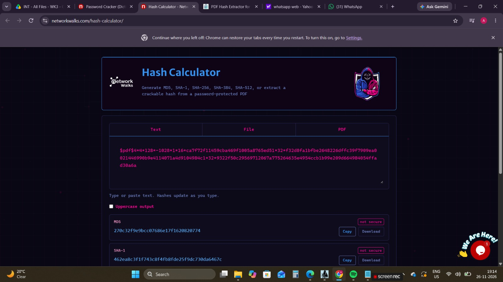
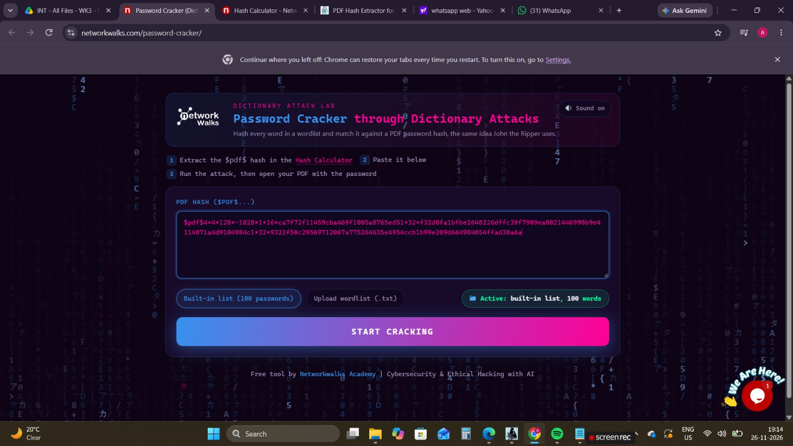

# Penetration Testing Report
## Password Security Assessment & Password Cracking

**W3-PM-FINAL | CYBERSECURITY | NETWORKWALKS**

| Field | Detail |
|---|---|
| Pentester Name | Abhishek Jain |
| Program/Batch | NetworkWalks Cybersecurity Internship |
| Date | 26 November 2026 |
| Modules Completed | W3-PM1: Password Cracking with JTR / W3-PM2: Password Cracking with NetworkWalks Tools |
| Target | Password-protected PDF files provided for the practical lab |
| Permission | Authorized educational lab |
| Phases Covered | Password Hash Extraction, Dictionary-Based Password Testing, Password Recovery & Analysis |

---

## Table of Contents

1. [Liability Disclaimer](#1-liability-disclaimer)
2. [Introduction](#2-introduction)
3. [Tools Used](#3-tools-used)
4. [Activities Performed](#4-activities-performed)
5. [Risk Analysis / Impact](#5-risk-analysis--impact)
6. [Recommendations](#6-recommendations)
7. [Conclusion](#7-conclusion)
8. [Evidence Collected](#8-evidence-collected)

---

## 1. Liability Disclaimer

All activities documented in this report were performed strictly for educational and cybersecurity research purposes within an authorized laboratory environment. The exercises involved password-protected files provided for practical testing.

These techniques should only be used on files, systems and accounts that you own or have explicit permission to test. Unauthorized access to protected information may be illegal and can lead to serious consequences. The instructor, authors and NetworkWalks are not responsible for misuse of the information contained in this report.

---

## 2. Introduction

This report documents the Week 3 password security practical conducted as part of the NetworkWalks Cybersecurity & Ethical Hacking Internship.

The practical focused on understanding password security, extracting password hashes from protected PDF files, and performing password recovery using two different approaches.

- **W3-PM1** used **John the Ripper (JTR)** in Kali Linux to analyze password-protected PDF files and perform dictionary-based password testing.
- **W3-PM2** used the **NetworkWalks Password Cracker application** to perform password testing and understand the password recovery process through a graphical interface.

These activities helped me understand how weak passwords can be recovered using dictionary-based techniques, why password strength matters, and how password security can be assessed in a controlled environment.

The exercises were performed on designated practical files and were not intended to access unauthorized files, accounts or systems.

---

## 3. Tools Used

| Tool | Purpose |
|---|---|
| Kali Linux | Linux environment for cybersecurity practicals |
| John the Ripper (JTR) | Password recovery and password strength testing |
| PDF Hash Extraction Tool | Extract password hashes from protected PDF files |
| NetworkWalks Application | Perform password testing using the provided application |
| Wordlist | Contains candidate passwords for dictionary-based testing |
| Terminal | Execute commands and analyze results |
| Screenshots | Record practical evidence and results |

---

## 4. Activities Performed

### 4.1 W3-PM1: Password Cracking Using John the Ripper

The objective was to understand how password-protected PDF files store password verification information and how password recovery tools test possible passwords against extracted hashes.

#### Step 1: Lab Setup

I prepared the Kali Linux environment and verified that the required password-testing tools were available. The password-protected PDF files provided for the practical were organized for testing.

**Observation:** The testing environment was ready for hash extraction and password analysis.

#### Step 2: Password Hash Extraction

I used the appropriate PDF hash extraction utility to extract the password hash from the protected PDF file. The extracted hash was saved into a text file so that it could be used by John the Ripper.

**Observation:** The password-protected PDF generated a hash representation that could be processed by a password auditing tool.

**Security significance:** Password hashes allow security professionals to evaluate password strength without directly testing access to the original document.

#### Step 3: Password Testing Using John the Ripper

I used John the Ripper to analyze the extracted PDF hash and perform dictionary-based password testing. The tool tested candidate passwords from a wordlist against the extracted hash. If a matching password was found, John the Ripper reported the recovered password.

**Observation:** The results depended on the password's complexity and whether a suitable candidate existed in the wordlist.

**Security significance:** Weak or commonly used passwords may be recovered relatively quickly, while stronger passwords can make password recovery significantly more difficult.

**Evidence:**

#### Step 4: Password Recovery Results

After completing the testing process, I reviewed the results and recorded whether the password was recovered. The results were documented separately for each provided PDF file.

**Evidence:**

---

### 4.2 W3-PM2: Password Cracking Using NetworkWalks Application

The second practical involved using the NetworkWalks security application to understand password testing and recovery through a graphical interface. The purpose was to perform the assigned password-security exercise using the application and compare the process with the command-line approach used in John the Ripper.

#### Step 1: Launching the NetworkWalks Application

I opened the NetworkWalks application and navigated to the password-cracking module.

**Observation:** The application provided a graphical environment for the password security practical.

**Evidence:**

#### Step 2: Selecting the Lab File

I selected the password-protected file provided for the practical and prepared it for password testing using the application.

**Observation:** The selected file was loaded into the password testing workflow.

#### Step 3: Performing Password Testing

I performed the password testing process using the options available in the NetworkWalks application. The application tested possible password combinations or dictionary entries and displayed the result of the process.

**Observation:** The result depended on the password and the testing method used by the application.

**Evidence:**

#### Step 4: Reviewing the Results

After the testing process completed, I reviewed the application output and recorded the result. I compared the process with the command-line testing performed using John the Ripper.

**Observation:** Both methods demonstrated how password-testing tools can evaluate password strength and attempt to recover weak passwords.

**Evidence:**

---

## 5. Risk Analysis / Impact

Based on the password security exercises, I identified the following potential security risks.

| # | Risk / Finding | Observation | Potential Impact | Risk Level |
|---|---|---|---|---|
| 1 | Weak passwords | Simple or commonly used passwords may be present in wordlists | Unauthorized access to protected files | High |
| 2 | Dictionary-based password attacks | Passwords based on common words may be guessed | Loss of confidentiality | High |
| 3 | Reused passwords | The same password may be used across multiple accounts or files | Multiple systems or files may become exposed | High |
| 4 | Predictable password patterns | Passwords based on names, dates or simple patterns may be easier to guess | Increased chances of password recovery | Medium |
| 5 | Insufficient password length | Short passwords may be easier to test against candidate lists | Reduced password security | High |
| 6 | Lack of password security awareness | Users may select easy-to-remember but weak passwords | Increased risk of unauthorized access | Medium |

**Risk level key:** Low / Medium / High / Critical

The practical demonstrated password testing techniques in a controlled environment. Password recovery results do not necessarily indicate that all passwords or files are vulnerable. The security risk depends on password complexity, length, uniqueness, storage method, and the password protection mechanism being used.

---

## 6. Recommendations

1. **Use strong and unique passwords** – Passwords should be long, unpredictable and different for each account or protected file.
2. **Avoid common passwords** – Do not use frequently used passwords, names, birthdays, keyboard patterns or dictionary words.
3. **Increase password length** – Longer passwords or passphrases significantly improve resistance to password guessing.
4. **Avoid password reuse** – Using the same password across multiple accounts increases the impact of a password compromise.
5. **Use a password manager** – Password managers can help users securely generate and store unique passwords.
6. **Protect sensitive PDF files** – Sensitive documents should be protected with appropriate encryption and strong passwords.
7. **Use multi-factor authentication** – Enable MFA wherever available to add another layer of protection.
8. **Conduct regular password audits** – Organizations should periodically review their password security practices.
9. **Improve security awareness** – Users should be educated about password guessing, dictionary attacks and credential security.
10. **Perform password testing only with authorization** – Password auditing should only be conducted on files or systems where permission has been granted.

---

## 7. Conclusion

During Week 3 of my Cybersecurity & Ethical Hacking internship at NetworkWalks, I completed practical activities related to password security and password recovery.

- In **W3-PM1**, I used John the Ripper in Kali Linux to understand PDF password hash extraction and dictionary-based password testing.
- In **W3-PM2**, I used the NetworkWalks application to perform password testing through its graphical interface and understand the password recovery process.

These exercises helped me understand how password hashes are used, how password testing tools work, and why weak passwords are vulnerable to dictionary-based attacks. I also learned the importance of password length, complexity, uniqueness and secure storage. The practical demonstrated that password security is an important part of cybersecurity and that weak passwords can create risks for individuals and organizations.

All activities were performed within an authorized educational laboratory environment.

---

## 8. Evidence Collected

### W3-PM1: Password Cracking Using John the Ripper (JTR)

| File | Description |
|---|---|
| [jtr .png](jtr%20.png) | Evidence of password cracking using John the Ripper |
| [passwordreveal using jtr.png](passwordreveal%20using%20jtr.png) | Password recovery result from John the Ripper |

### W3-PM2: Password Cracking Using NetworkWalks Application

| File | Description |
|---|---|
| [networkwalksapp.png](networkwalksapp.png) | NetworkWalks application interface |
| [networkwalkswebapp2.png](networkwalkswebapp2.png) | Additional screenshot of the application and its workflow |
| [passwordreveal.png](passwordreveal.png) | Evidence of the password recovery result |

All screenshots are included as evidence of the practical activities performed during Week 3 of the NetworkWalks Cybersecurity Internship.

---

**Intern:** Abhishek Jain
**Program:** NetworkWalks Cybersecurity & Ethical Hacking Internship
**Practical:** Week 3, Password Security & Password Cracking
**Modules:** W3-PM1 & W3-PM2
